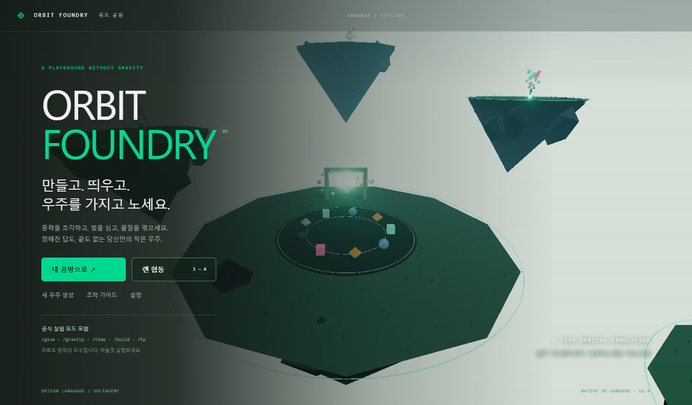

# ORBIT FOUNDRY · 궤도 공방

[Windows 실행 파일 다운로드](https://github.com/illililiiililii/new-sandbox-game/releases/tag/v1.0.0)

공중섬에서 중력, 물질, 빛으로 노는 Windows 3D 물리 샌드박스입니다.
사이트가 아닌 독립 데스크톱 게임입니다. 실행 시 인터넷에 연결할 필요가 없습니다.

## 실행

배포 폴더 전체를 유지한 채 **ORBIT FOUNDRY.exe**를 실행하세요.
Node.js나 별도 런타임 설치는 필요 없습니다. Windows x64 전용입니다.

## 조작

화면을 클릭하면 마우스 시점 조작이 시작됩니다. ESC로 마우스를 놓습니다.

| 키 | 기능 |
|---|---|
| WASD / 마우스 | 이동 / 시점 |
| Space / Ctrl | 상승 / 하강 |
| Shift | 빠른 비행 |
| 1–6 | 물질 / 중력 / 씨앗 / 파동 / 연결 / 회수 도구 |
| 좌클릭 / 우클릭 | 자유 물질 / 고정 물질. 중력 도구는 인력 / 척력 |
| Q / B / 마우스 휠 | 재질 / 형태 / 크기 |
| G | 조준한 물질 고정·해제 |
| 가운데 클릭 | 조준한 물질의 재질·모양 복사 |
| Ctrl+Z | 마지막 생성 되돌리기 |
| C | 공식 실험실 |
| T 또는 / | 치트 콘솔 / 협동 채팅 |
| E | 도구 가이드 |
| F / Home | 비행 방식 전환 / 중앙 공방으로 |
| F11 | 전체 화면 |

## 랜 협동 · 최대 4명

각 PC에서 동일한 게임을 실행합니다. 같은 공유기나 와이파이에 연결하세요.
방장은 **랜 협동 → 내 공방 열기**를 누릅니다. 게임 왼쪽 위에 표시되는
`192.168.x.x:3579` 같은 주소를 동료에게 전달합니다. 방 주소는 자동으로 클립보드에 복사됩니다.
동료는 **랜 협동 → 방장 주소 입력 → 연결**을 누릅니다.

Windows가 네트워크 접근을 물으면 사용자가 직접 허용해야 합니다.
기본 포트는 TCP 3579이며 외부 인터넷 포트 전달은 필요 없습니다.
게스트 와이파이의 기기 격리 기능이나 VPN은 연결을 막을 수 있습니다.
방장이 게임을 닫으면 공방 서버도 종료됩니다. 협동 세계는 방장 PC에 저장됩니다.
모든 참가자가 공식 치트를 사용할 수 있는 신뢰하는 동료용 실험 공방입니다.

## 공식 치트

`/help`, `/give 비취 30`, `/give 금 20`, `/give 분홍 30`,
`/spawn core`, `/spawn seed`, `/gravity 0`, `/gravity 9.8`,
`/time day`, `/time sunset`, `/time night`, `/weather meteor`,
`/weather clear`, `/build ring`, `/build helix`, `/build bridge`,
`/tp 0 20 0`, `/speed 25`, `/fly`, `/god`, `/home`, `/clear`, `/undo`, `/seed`.

`/clear`는 자유 물질을 회수하며 고정 구조물을 보존합니다.
`/undo`는 생성 작업을 되돌립니다. 회수한 단일 물질도 다시 복원할 수 있습니다.

## 저장과 기술 범위

20초마다 자동 저장하며 메뉴에서 즉시 저장할 수도 있습니다. 사용자 앱 데이터의
`orbit-world.json`에 세계를 저장합니다. 메인 화면의 ‘내 공방으로’는 저장본을 이어서 엽니다.
‘새 우주 생성’ 후 저장하면 현재 저장 슬롯이 새 세계로 갱신됩니다.

최대 물질 수 650개, 최대 참가자 4명, 유한한 공중섬 공간입니다.
물질 충돌은 구 형태의 근사 판정을 사용합니다. 복잡한 강체 엔진의 정밀 접촉과는 차이가 있습니다.
중력 앵커·탄성 연결·결정 성장·유성우를 함께 실험할 수 있습니다.

## 개발

Node.js 22.12 이상에서 `npm ci`, `npm start`. 검사는 `npm test`.
Windows 배포는 `npm run package`이며 `release-builds/`에 실행 폴더를 만듭니다.
Electron 45.2.3과 Three.js 0.187.0을 사용하며 Three.js 실행 모듈은 `dist/vendor/`에 포함했습니다.
저장소는 게임 소스, 큰 Windows 실행 ZIP은 GitHub Releases에서 제공합니다.
디자인 토큰과 UI 원칙은 아래 자료를 바탕으로 게임에 맞게 적용했습니다.

- [VoltAgent awesome-design-md](https://github.com/VoltAgent/awesome-design-md/tree/main/design-md/voltagent)
- 함께 제공한 DESIGN-LICENSE, THREE-LICENSE, WS-LICENSE 및 Electron 라이선스 참조.
